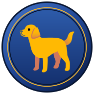
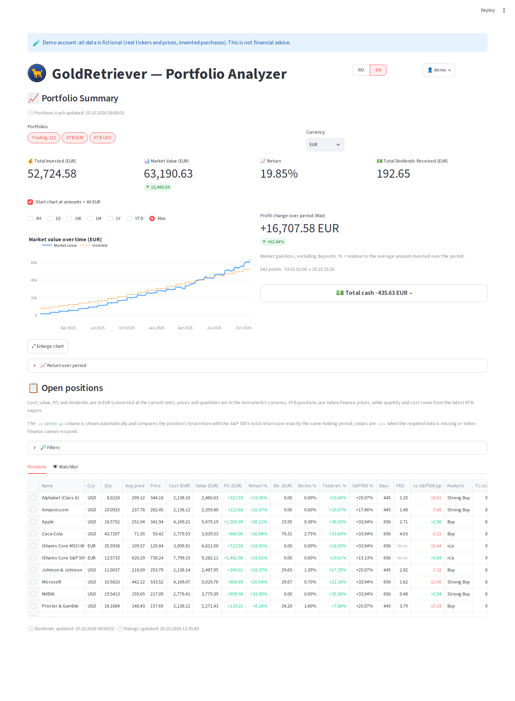
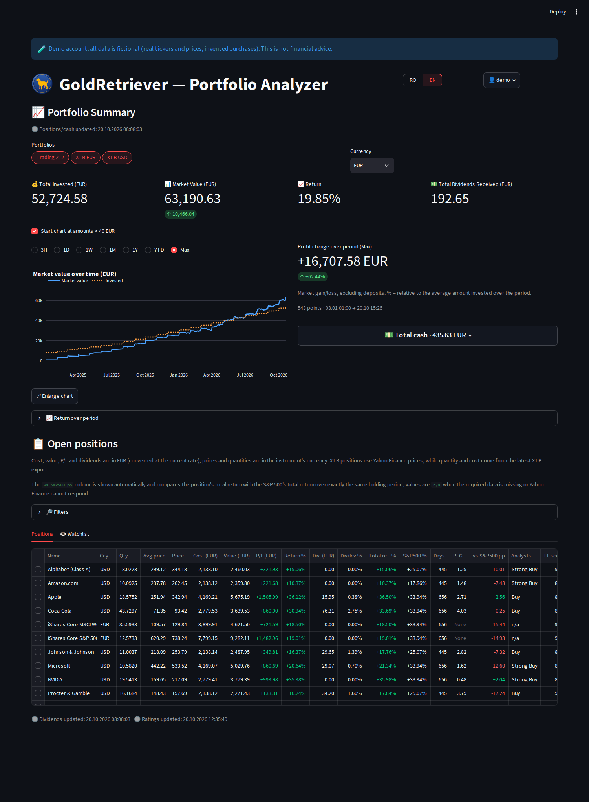
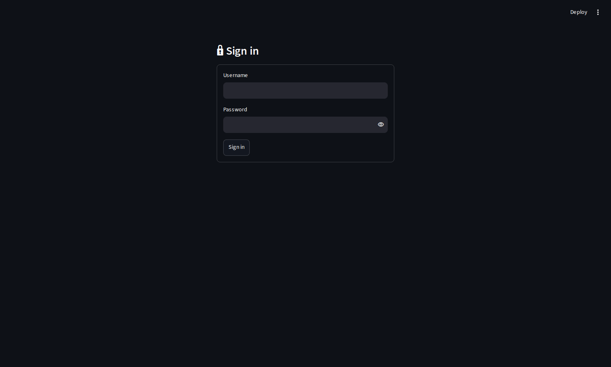
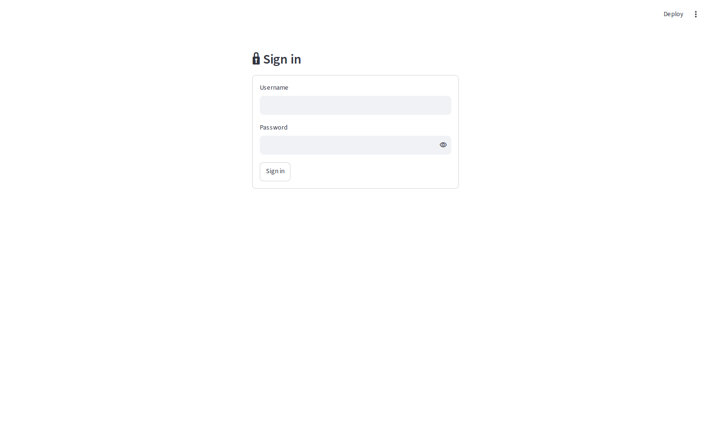

# GoldRetriever — self-hosted portfolio tracker for Trading 212 and XTB

<p align="center"></p>

**GoldRetriever is a self-hosted portfolio tracker for Trading 212 and XTB (Interactive Brokers planned), built with Streamlit and Docker: multi-user, any display currency, Romanian/English interface.** Your data stays on your own machine.

It brings your broker accounts into one view with returns, dividends, scores, analyst data, strategy lenses, exposure analysis and email alerts.

*Keywords: self-hosted, open source, portfolio tracker, stock portfolio, ETF, dividends, Trading 212, XTB, Streamlit, Docker.*

<picture>
  <source media="(prefers-color-scheme: dark)" srcset="docs/screenshots/main-dark.png">
  
</picture>

## Features

| Area | What it does |
| --- | --- |
| Brokers | Trading 212 (API) and XTB (xlsx report import) in one view, with any number of accounts. Interactive Brokers is planned. |
| Currency | Display in any currency, chosen per user; exchange rates from Yahoo Finance |
| Performance | Market value over time (value vs. invested), return summary and XIRR |
| Positions | Per-position profit/loss, dividends and comparison with the S&P 500 over the same holding period; detail page for every instrument |
| Scores | Quality, risk and dividend scores; ETF data from justETF |
| Analysts | Price targets, recommendations, EPS and revenue estimates and revisions |
| Strategy lenses | Value, growth, dividend discount model, dividend growth, sentiment, event-driven, trend & momentum, with verdicts, the signals behind them and how many of your profile's lenses agree |
| Event timeline | SEC 8-K filings, ratings, insider trades, earnings and classified news |
| Exposure | Sector and country (both with ETF look-through) and currency; sector rotation (RRG of sector ETFs vs. the S&P 500) and factor exposure (beta, size, value, momentum, quality, low volatility, dividend) |
| Comparison | Side by side for up to five instruments: return chart, scores, valuation |
| Events calendar | Upcoming earnings, ex-dividend and payment dates for held positions, with an optional email digest |
| Alerts | Watchlist, loss-to-profit alerts, position alerts on price, score and concentration (in-app banner and email) |
| Admin notifications | Email (SMTP) for failed backups, failed refreshes, XTB import problems and security events |
| Multi-user | Separate data per user, admin page for accounts, signed login cookie |
| Interface | Romanian and English, light and dark theme, phone layout, hidden amounts mode |

## Quick start with Docker Compose

```bash
git clone https://github.com/ioanv2909/gold-retriever.git
cd gold-retriever
docker compose up -d --build
```

Open http://localhost:8501. On the first visit you create the admin account. To use another port: `PORT=8080 docker compose up -d`.

The included `docker-compose.yml`:

```yaml
services:
  gold-retriever:
    build: .
    container_name: gold-retriever
    user: "1000:1000"
    environment:
      - HOME=/tmp
    ports:
      - "${PORT:-8501}:8501"
    volumes:
      - ./data:/app/data
    restart: unless-stopped
```

## Connect your accounts

- **Trading 212:** sidebar, *Trading 212 authentication*. Enter an API key ID and secret (create the key with read-only permissions).
- **XTB:** sidebar, *XTB — import*. Upload the xlsx account report (sheets *Open Positions*, *Cash Operations*, *Closed Positions*). You can import several accounts (EUR, USD, RON, ...).

## Screenshots

| Dark | Light |
| --- | --- |
|  |  |
|  |  |

<!-- More screenshots (add the files, then uncomment):
|  |  |
|  |  |
|  |  |
|  | |
-->

## Try the demo

Creates a `demo` user with a fictional portfolio: real tickers and real prices, invented purchases. It needs internet access for the prices.

```bash
docker compose exec gold-retriever python tools/make_demo.py
docker compose exec gold-retriever python tools/make_demo_t212.py
docker compose exec gold-retriever python tools/make_demo_history.py
```

Log in as `demo` / `demo`.

## Security notes

- API keys are stored in plain text in the mounted data volume. Protect that folder and its backups.
- There is no built-in HTTPS. Put the app behind a reverse proxy or a VPN before exposing it to the internet.
- The first visitor creates the admin account, so do it right after starting the app.
- The container runs as uid 1000 (see `docker-compose.yml`); the data folder must be writable by that user.

## Development

Python 3.10, dependencies in `requirements.txt`. CI compiles the code, checks that every import resolves and runs the tests. To regenerate the screenshots of the demo account:

```bash
docker run --rm --network host -v "$PWD":/w mcr.microsoft.com/playwright/python:v1.49.0-noble \
  sh -c "pip install -q --break-system-packages playwright==1.49.0 && python /w/tools/screenshots.py"
```

## Support

GoldRetriever is free and open source. If it is useful to you, you can support its development:

[](https://ko-fi.com/goldretriever)

## License

MIT, see [`LICENSE`](LICENSE). The dog in the logo is derived from Noto Emoji (Google, Apache License 2.0), see `assets/NOTICE-artwork.txt`.

This is not financial advice. The project is not affiliated with Trading 212, XTB, Interactive Brokers, Yahoo or justETF; check their terms before using their data.
